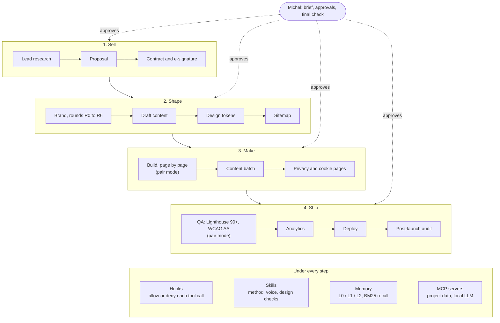
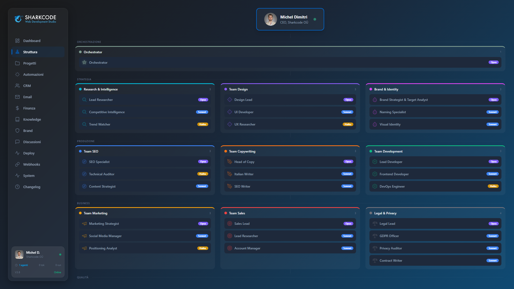
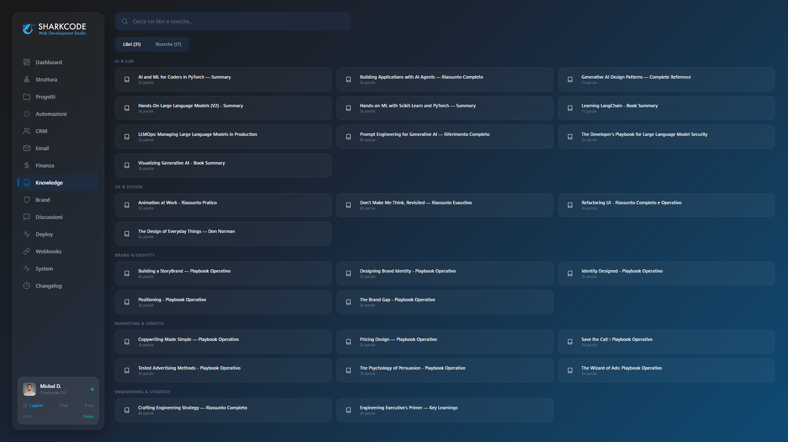
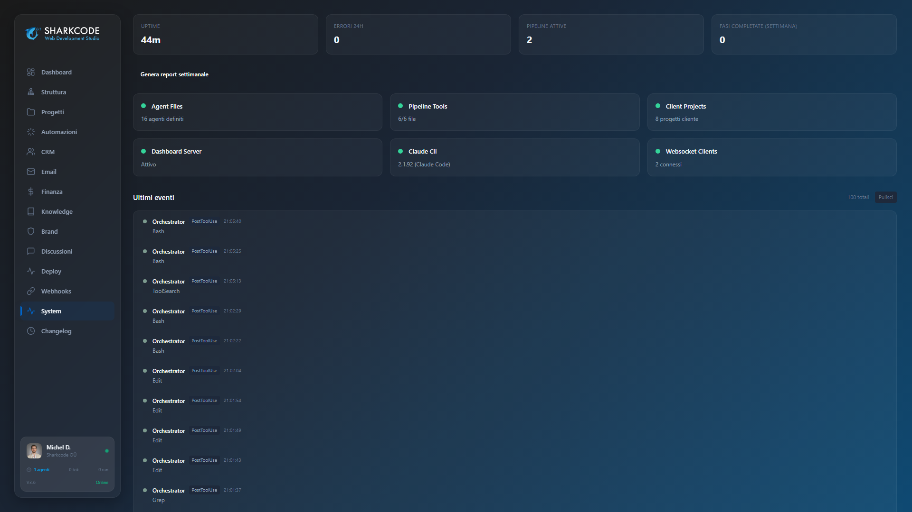
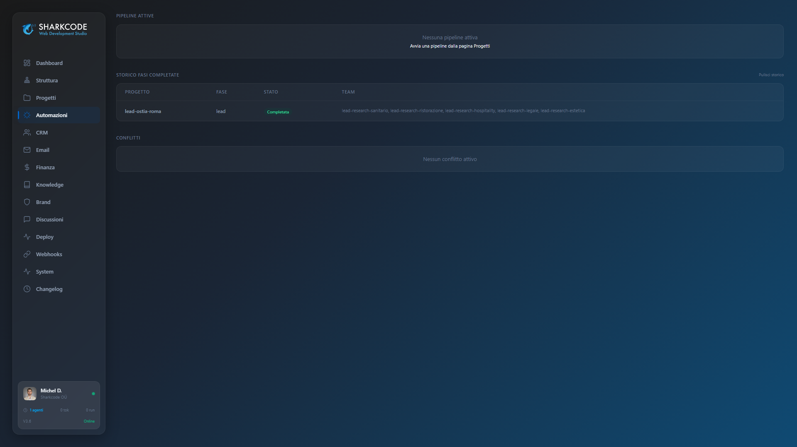

# Sharkcode OS

Sharkcode OS is the set of Claude Code agents, skills and hooks that runs [Sharkcode](https://sharkcodestudio.com), a small web studio that builds websites and online shops for small businesses in Italy.
Built with Claude Code, designed and reviewed by [Michel Dimitri](https://github.com/Michel9329).

This page explains how the system works. It contains no code: the code and the data it runs on are private, for the reasons given in [What is not public](#what-is-not-public).

## How it is built

The whole agency lives in one git repository opened in Claude Code. Michel sets the brief, approves at fixed checkpoints and checks the result. Between those points, Claude Code agents do the research, the writing, the building and the checking.

### The pipeline

Every client goes through the same pipeline, from the first contact to an audit after launch.

Most phases run through one command, `/run-pipeline <client> <phase>`. It hands the work to a team of agents, checks that each agent wrote the files it promised, and stops for Michel's approval before the next round. Brand work, for example, stops at round R2 so Michel can choose the palette before anything is built on it.

Two phases are pair mode by design: building the pages and QA run in the main Claude Code session, with Michel looking at each result.

### The parts

Counts measured on 6 November 2026. The commands are listed under [How the numbers were measured](#how-the-numbers-were-measured).

| Part | What it does | Count |
|---|---|---|
| Agents | One Markdown file per role in `.claude/agents/`: lead research, naming, legal, copywriting, SEO, accessibility, QA, fact checking and more. Each has its own tool allowlist. | 46 |
| Skills | Procedures loaded on demand. Some were written for this workspace (the work method, Michel's writing voice, a check against AI-sounding text, the visual check before "done"). Others come from public collections (design review, animation, SEO). | 67 |
| Hooks | Scripts Claude Code runs on session events. Seven run before a tool call and can deny it. | 17 |
| Memory | One fact per file. Next to each full text (L2) sit a short abstract (L0) and an overview (L1). | 931 memory files, 1,264 indexed entries |
| MCP servers | Two written for the workspace. One gives agents access to client briefs, other teams' output, pipeline status and the knowledge base, and lets them post to discussion threads. The other connects a local model through Ollama for embeddings, classification and summaries. | 2 (12 and 4 tools) |
| Orchestrator | TypeScript that compiles contracts, proposals and brand books from HTML templates, validates agent output, and saves pipeline state so an interrupted run resumes from the last finished agent. | 26,141 lines in 74 files |
| History | Commits since the first one on 24 March 2026. Most of them were made by Claude Code agents working under Michel's direction: 4,223 carry a Claude co-author line. | 5,661 |

**How recall works.** On every prompt a hook runs a BM25 search over the abstracts and injects the most relevant ones into the context, capped at 3,000 tokens. The overview or the full file is loaded only when the task needs it, so a session gets the relevant notes without opening hundreds of files.

## How it enforces the rules

The project rules live in `CLAUDE.md`, and a model can lose track of them in a long session. So the rules that matter most also exist as code. In the words of `CLAUDE.md`: the prose is the why, the hooks are the how.

### Hooks that deny tool calls

Seven hooks run before a tool call and can refuse it.

- **Method gate.** In a session, the first edit in a client folder is denied until the method skill has been loaded. Client-facing text also needs the voice skill, and most other text needs the skill against AI-sounding writing. The gate was added on 9 July 2026, after a commercial proposal had been produced in 1 hour 32 minutes, skipping both the method and the voice checks. After three denials with no new skill loaded it lets the call through with a warning, so a broken tracker cannot lock a session. It does not see files written through the shell: it stops honest forgetting and does not pretend to be a sandbox.
- **Protected paths.** Document compilers, legal and brand templates, and agent definitions can only be edited if the active phase holds an AUDIT file with `approved_by: Michel` and an approval date less than 14 days old. When the check cannot pass, the edit is denied.
- **Deliverable text.** In client folders, loading Google Fonts from Google's CDN is denied (a 2022 German court ruling held that it passes visitor IP addresses to Google without consent). An apostrophe typed in place of an Italian accented letter is denied. An em dash gets a warning.
- **Git discipline.** `git commit --amend`, commits without explicit file paths, and recursive forced deletes are denied.
- **Client isolation.** A write to one client's site is denied if it contains brand terms that belong to a different client.
- **Agent allowlists.** An edit to an agent definition is denied if its prompt starts to mention a tool that the agent's allowlist does not grant.
- **Reuse first.** The first edit to a client site's UI in a session is denied until the existing components from past projects have been checked.

Most of these hooks are public, without client data, as [claude-code-guardrails](https://github.com/Michel9329/claude-code-guardrails).

### A skill for the method

Before any non-trivial task the session loads `fable-method` (named after Claude Fable 5: the procedure was distilled from how that model worked on this workspace), a procedure with an output for each stage:

0. **Frame.** One sentence of the form `done = <observable result>`, plus the decisions that belong to Michel, listed before the work starts.
1. **Scout.** A few cheap tool calls to measure sizes, counts and git state. No claim, plan or estimate comes before this.
2. **Split** the problem into parts that can be investigated in parallel, each with a precise question.
3. **Try to disprove** each finding. An important one needs a second, independent confirmation.
4. **Plan backwards** from the goal, reusing what already exists before adding anything new.
5. **Execute with a stop rule.** Two attempts at the same problem without closing it means stop and review the structure. There is no third attempt on the same approach.
6. **Done means seen working** at runtime. A green build does not count.
7. **Ask "what am I missing?"** before closing: unpushed commits, files an agent promised and never wrote, side effects on other projects.

The skill comes with a casebook of 13 real episodes, each written as situation, reasoning, move and lesson.

### Model routing

The routing table starts from one rule: expensive judgment, cheap execution. The pipeline orchestrator runs on Opus, the specialists on Sonnet, the mechanical checkers (language checker, dependency auditor, visual checker) on Haiku. The model that grades is never the model that wrote. A retry never moves to a smaller model: the prompt gets simpler instead. Effort follows the role as well, high for audits, medium to high for writers, low to medium for checks, and the number of parallel agents is fixed before they launch.

The table also lists its own debts. Agent files still declare `effort: max` on 24 agents, `xhigh` on 8 and `high` on 13, which contradicts the effort rule. The fix is still open.

### If you build on Claude Code

The patterns that carry over to other projects:

- A gate can require a step (load the method skill) instead of only forbidding actions. A rule the model had to remember becomes a step it cannot skip by accident.
- A gate that requires a step counts its own denials and fails open after a few, so a bug in the gate cannot stop the work. Gates that protect files do the opposite and fail closed.
- Overrides go through a file with a named approver and an expiry date, so an old approval cannot linger.
- Every memory file gets a short abstract next to it. Recall searches the abstracts and loads the full text only on demand.

## Four lessons from the casebook

The figures below are the ones written in the casebook when each episode happened, in July 2026.

**1. Judge an integration with real data.** A lead pipeline had been "working" for months. Instead of reading the code and finding it plausible, the agent ran the parser's regular expressions on the real output of a past run: zero matches. The format the agent wrote and the format the parser expected had been written in different phases and never compared. The fix was a structured JSON contract as the main source, with the old expressions kept as a fallback.

**2. When data lies, ship the fix and the guardrail.** The dashboard's org chart declared 54 agents, while the folder held 46: two were ghosts and eight real ones were missing. Correcting the config was half the job. The other half was a test that compares the config with the agent folder and fails on any drift.

**3. "The code is there" does not mean "the code runs".** A legal page looked missing from a client site. The page existed, and so did the code meant to link it from the footer. That code used an exact string replace that no longer matched (a trailing slash and an extra `rel` attribute), and it had been failing silently for weeks. Since then a patch on text written by someone else is checked in three places: the source, the build output and the live site.

**4. Parallel agents are not free.** 46 agents launched at once, all at high effort, used 70% of a five-hour usage window in 15 minutes, and the work was cut off. Since then the number of agents, their effort and their context are decided before a fan-out, and high effort goes only where judgment is needed.

The thread through all 13 episodes: trust goes to artifacts, not to stories. That includes "it should work", an agent reporting "completed", and "the database says so". Each of those has a cheap check on the real artifact, and the check comes first.

## Related repositories

| Repository | What it is |
|---|---|
| [claude-code-guardrails](https://github.com/Michel9329/claude-code-guardrails) | The hooks described above, separated from client data. |
| [humanizer-it](https://github.com/Michel9329/humanizer-it) | A Claude Code skill for Italian text that should not read as machine-written, with write, rewrite and audit modes. Italian first, English too. |
| [gdpr-scanner](https://github.com/Michel9329/gdpr-scanner) | A Cloudflare Worker that opens a site in a headless browser and reports privacy and cookie policy links, the consent banner, Google Fonts loaded from the CDN, Google Consent Mode, and trackers that fire before consent. |
| [image-review-portal](https://github.com/Michel9329/image-review-portal) | Image approval with versions, comments pinned to a point and a configurable number of sign-offs. |

## What is not public

- **Client code and data.** Site repositories, briefs, contracts, invoices and the notes on each project belong to the clients under their contracts.
- **The working system.** The orchestrator, the agent prompts and the memory were written around those files and refer to them, so publishing them would publish client information. The parts that can be separated cleanly are being moved into the repositories above.
- **Real figures.** The screenshots below come from the system itself, with client data left out or blurred.

## Screenshots

These are from April 2026, when the dashboard was at version 3.6. The system has grown since: the org chart shows the agent teams of that time, not the 46 agents of today.

*Structure. The agent teams of April 2026 grouped by stage (orchestration, strategy, production, business), with the model each role ran on.*

*Knowledge. Book summaries the agents can search, grouped by area. There were 31 then; the research folder now holds 46.*

*System. Health checks for agent files, pipeline tools and the dashboard server, above the live stream of hook events from the session.*

*Automations. Run history: a lead research phase split across five sector agents, all completed.*

## Contact

[sharkcodestudio.com](https://sharkcodestudio.com)

## How the numbers were measured

Run on the private workspace on 6 November 2026.

| Number | Command |
|---|---|
| 46 agents | `git ls-files .claude/agents \| grep '\.md$' \| grep -vE '\.(abstract\|overview)\.md$' \| wc -l` |
| 67 skills | `ls .claude/skills/*/SKILL.md \| wc -l` |
| 17 hooks, 7 before tool calls | `ls .claude/hooks \| grep -E '\.(mjs\|sh)$' \| wc -l`, then the `PreToolUse` entries in `.claude/settings.json` |
| 2 MCP servers, 12 and 4 tools | `ls tools/mcp-servers`, then the tool registrations in each `index.ts` |
| 26,141 lines, 74 files | `git ls-files tools/orchestrator \| grep '\.ts$' \| xargs cat \| wc -l` (22,307 without test files) |
| 5,661 commits | `git rev-list --count HEAD`; first commit dated 2026-03-24 |
| 4,223 with a Claude co-author | `git log --format="%H %(trailers:key=Co-Authored-By,valueonly,separator=;)" \| grep -ci "claude\|anthropic"` (one line per commit) |
| 931 memory files, 1,264 entries | `research/INDEX.yaml`, entries counted by `scope` (memory, intel, research, skills, agents, commands, constitution) |
| 3,000 token recall cap | `budget.max_tokens` in the retrieval config |
| 24 / 8 / 13 effort settings | `grep -h '^effort:' .claude/agents/sharkcode-*.md \| sort \| uniq -c` |
| 46 book files | `ls research/book-*.md`, excluding the abstract and overview files |

## License

Text and screenshots: Copyright (c) 2026 Michel Dimitri. All rights reserved. The code-free page can be quoted with a link back.
